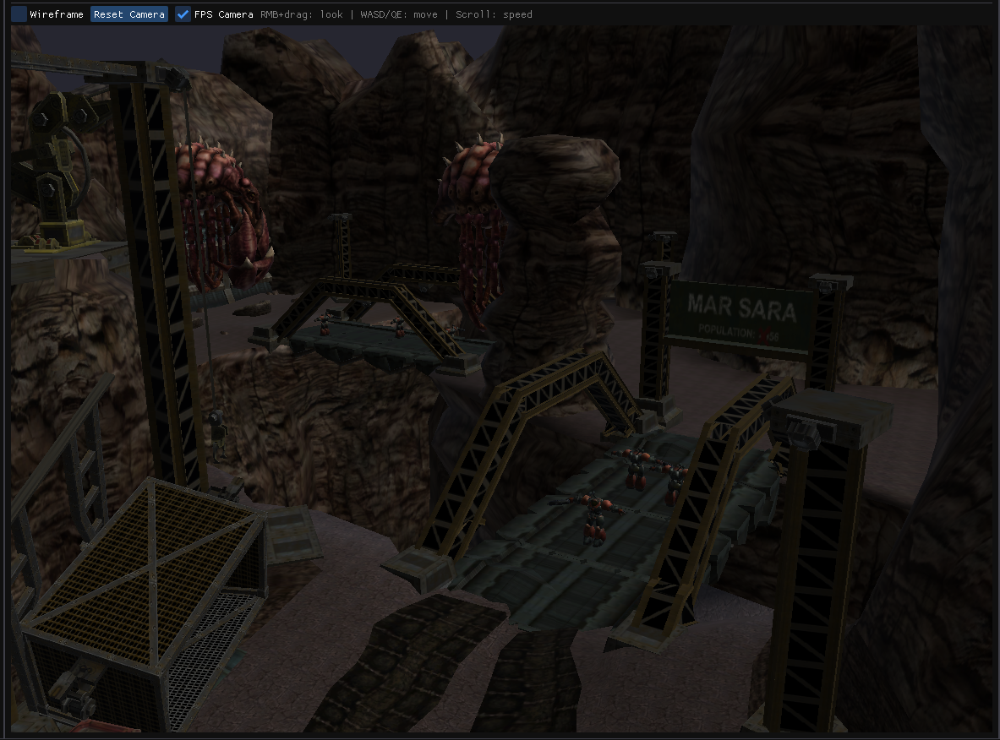
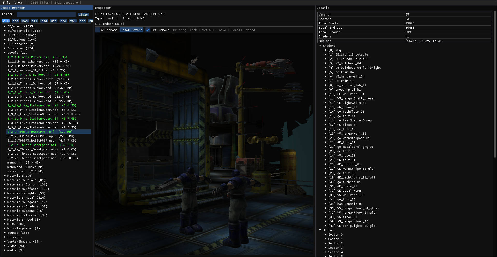
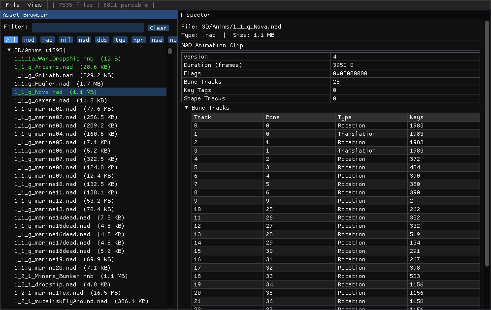
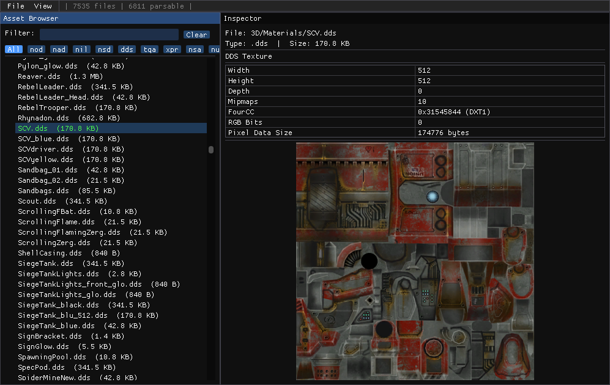
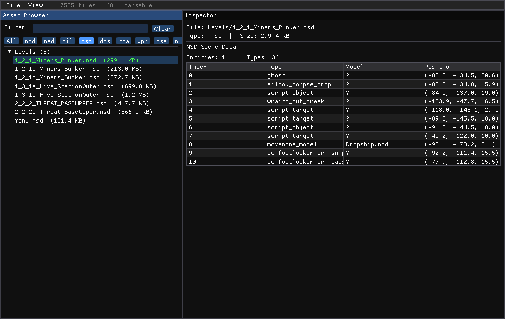
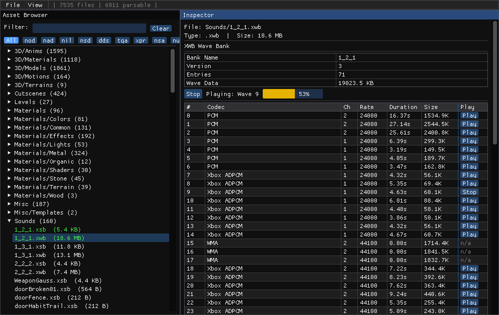

# OpenNOD SDK — SC:Ghost Reversed

An ongoing reverse-engineering effort focused on Nihilistic Software's NOD engine, the technology that powered StarCraft: Ghost during its development between 2001–2004. Based on an early Xbox prototype build.



| | | |
|---|---|---|
|  |  |  |
|  |  | |

## What's inside

| Component | Description |
|---|---|
| `src/parsers/` | C++17 static library — parsers for all major NOD asset formats |
| `src/viewer/` | OpenGL asset browser with ImGui UI |
| `plugin/bpy-nodsdk-scghost/` | Blender 4.x import plugin (NOD, NMB, NIL, NAD) |

### Parsed formats

| Extension | Content |
|---|---|
| `.nod` | Rigid / skinned mesh model |
| `.nmb` | Multi-body compound mesh bundle |
| `.nil` | Indoor level geometry (sectors + props) |
| `.nad` | Skeletal animation clip |
| `.nak` | Camera keyframe animation |
| `.nsd` | Scene description (entity placement) |
| `.nce` / `.ncs` | Cutscene data |
| `.nco` | Conversation / subtitle data |
| `.nls` / `.nlt` | Localised string tables |
| `.nfx` / `.nlfx` | Particle / effect descriptors |
| `.nui` | UI layout |
| `.not` | Object template definitions |
| `.npd` | Patrol / path data |
| `.noc` | Occlusion / collision mesh |
| `.nms` | Material / surface definition |
| `.nsa` | Sound archive manifest |
| `.nnb` | NavMesh baked data |
| `.xwb` / `.xsb` | Xbox wave bank / sound bank (ADPCM) |
| `.xpr` | Xbox packed resource (textures) |
| `.dds` | DirectDraw Surface texture |
| `.tga` | Targa texture |

---

## Dependencies

### Viewer (Linux / macOS)

| Package | Purpose |
|---|---|
| CMake ≥ 3.16 | build system |
| GCC / Clang (C++17) | compiler |
| OpenGL | rendering |
| GLFW 3.3+ | window + input |
| GLEW | GL extension loader |
| GLM | math library |

Install on Ubuntu / Debian:

```bash
sudo apt install cmake g++ libglfw3-dev libglew-dev libglm-dev
```

Install on Arch:

```bash
sudo pacman -S cmake glfw glew glm
```

### Blender plugin

Blender 4.0 or later. No additional Python packages required.

---

## Build

```bash
cmake -B build/cmake
cmake --build build/cmake --target nodsdk-viewer -j$(nproc)
```

The binary and libraries are written to `cmake/`.

---

## Running the viewer

```bash
cd cmake
./nodsdk-viewer <assets-directory>
```

`<assets-directory>` should be the root of the extracted game asset tree (the directory that contains subdirectories like `models/`, `textures/`, etc.).

The browser panel on the left lets you browse by asset type. Click any entry to preview it. Supported previews:

- **NOD / NMB** — 3-D mesh with orbital camera, skinning, optional animation playback
- **NIL** — full level geometry with entity instances
- **DDS / TGA / XPR** — texture preview
- **NSD** — entity list with type classification
- **NAD** — animation clip details
- **NCE / NCS** — cutscene actor + event list
- **XWB / XSB** — wave bank audio playback (via `aplay`)

---

## Blender plugin

### Install

```bash
cd plugin
zip -rq bpy-nodsdk-scghost.zip bpy-nodsdk-scghost/ -x '*/__pycache__/*'
```

In Blender: *Edit → Preferences → Add-ons → Install* → select the zip → enable **OpenNod SDK-scghost**.

### Importers

| Menu entry | Format | Notes |
|---|---|---|
| File → Import → NOD Model (.nod) | `.nod` | rigid or skinned mesh; creates armature if bones present |
| File → Import → NMB Bundle (.nmb) | `.nmb` | multi-body compound mesh |
| File → Import → NIL Level (.nil) | `.nil` | full indoor level; props baked to world space |
| File → Import → NAD Animation (.nad) | `.nad` | animation clip; requires an active armature in the scene |

---

## Project goals

- Open, educational reference on early-2000s console engine design
- Document the NOD engine asset formats completely
- Respect for original authors (Nihilistic Software, Blizzard Entertainment, Activision)

## Why this matters

StarCraft: Ghost is one of the most iconic cancelled games in Blizzard history. The NOD engine also powered *Vampire: The Masquerade — Redemption*. Studying this prototype gives rare insight into Blizzard's early console strategy and Nihilistic's proprietary technology.

---

*Licensed under GNU GPL v3. See individual source files for full copyright notices.*